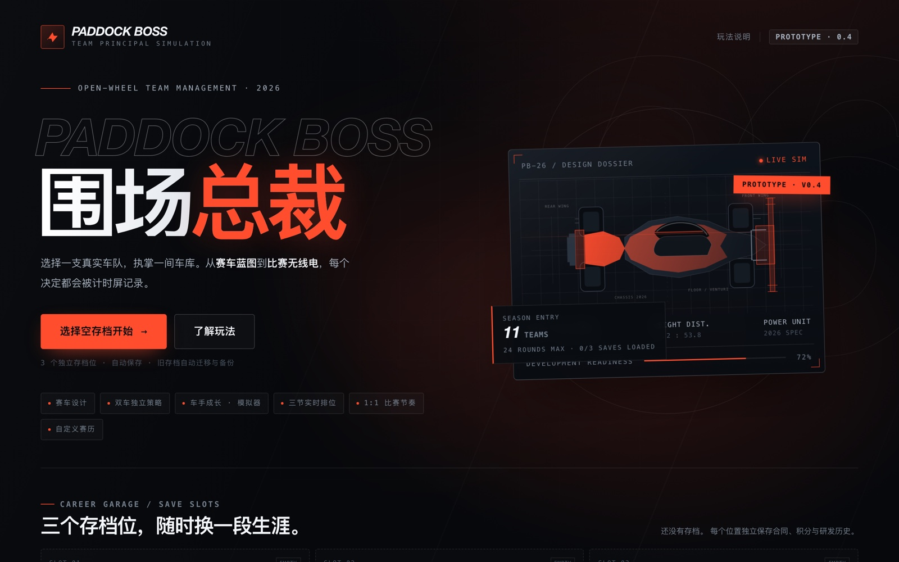
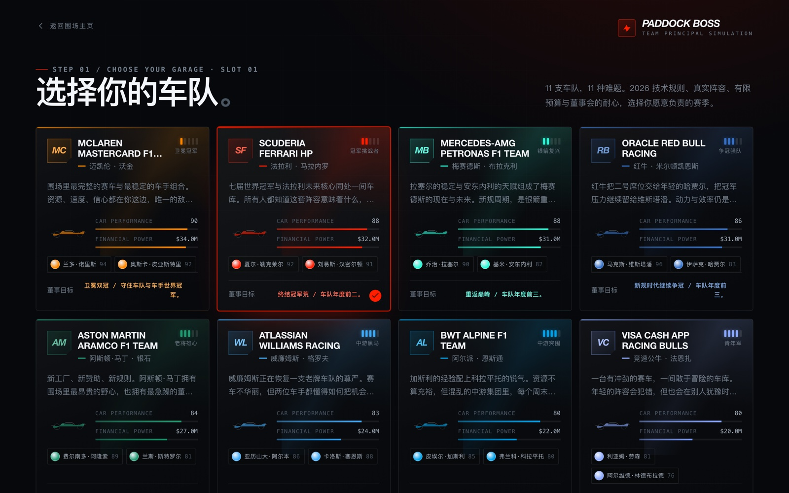
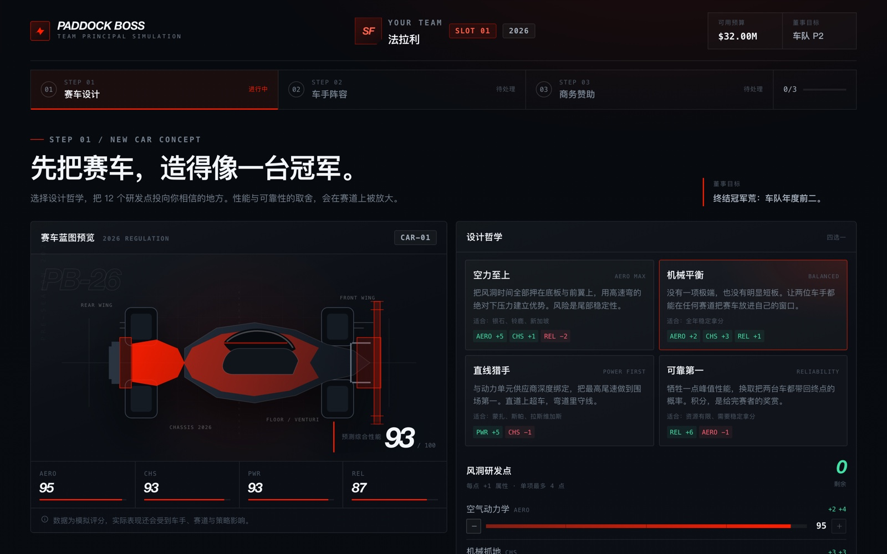
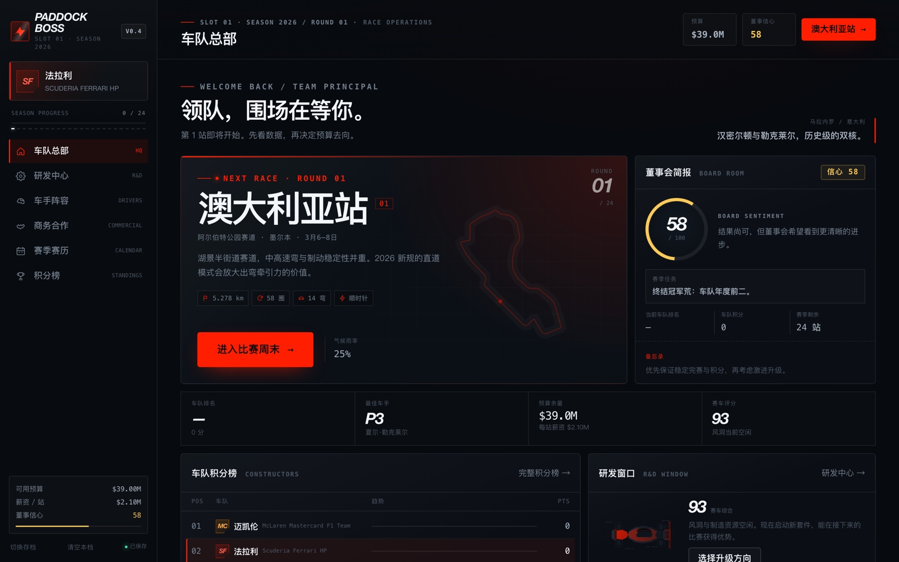
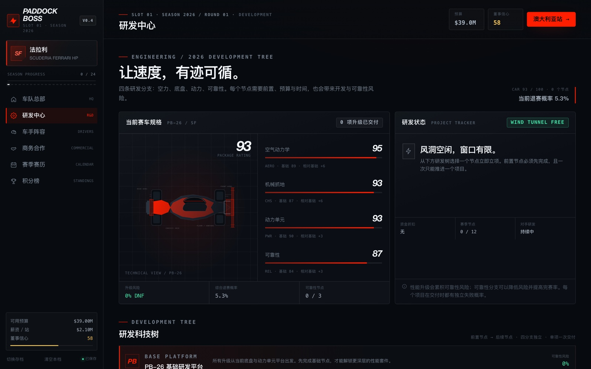
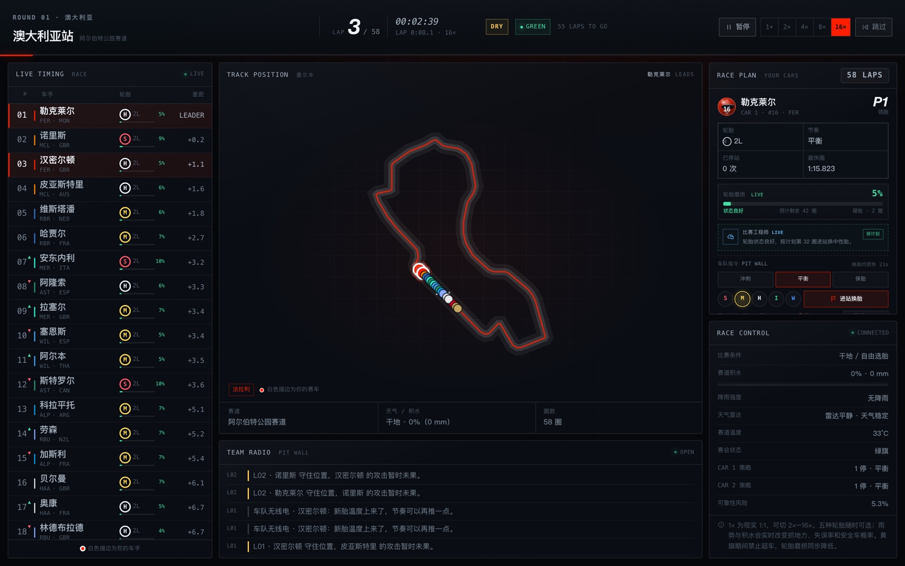

# PADDOCK BOSS · 围场总裁

<p>
  <a href="LICENSE"></a>
  
  
  
</p>

**2026 F1 车队经营模拟 · 单文件浏览器原型**

> 你不开车。你决定谁能赢。

选择一支 2026 车队，从赛车蓝图、车手合同和赞助谈判开始，亲手跑完三节排位与 1:1 实时正赛。整个游戏装在一个 `index.html` 里：零依赖、零后端、可离线运行。

本项目是非官方粉丝原型，与 Formula 1、FIA、各车队、车手及赞助商均无关联，也未获其授权或认可。

<p>
  
</p>

## 快速开始

下载或克隆本仓库，直接打开 `index.html` 即可。不需要安装依赖，也不需要联网。

```bash
open index.html          # macOS
# 或者直接双击 index.html
```

如果浏览器限制了 `file://` 页面的本地存储，用一个静态服务器打开：

```bash
python3 -m http.server 8000
# 浏览器访问 http://localhost:8000
```

推荐使用较新版本的 Chrome、Edge、Firefox 或 Safari。游戏需要启用 JavaScript 和本地存储（localStorage）。

## 怎么玩

1. **选车库。** 在主菜单选择一个空存档位，再从 11 支车队中签下你的领队合同。
2. **做三个季前决定。** 选择设计哲学并分配 12 个研发点；确认或更换两位车手；签下一份主赞助合同。你也可以编辑本赛季赛历。
3. **跑比赛周末。** 完成三节练习赛，参加 Q1–Q3 实时排位，为两台赛车分别设定轮胎、进站窗口和驾驶模式，然后进入正赛。
4. **经营整个赛季。** 在研发中心推进升级，用模拟器培养车手，管理预算、奖金、士气和董事会信心。
5. **进入下一年。** 赛季结束后查看总结，在休赛期处理合同、续约、换人和新赞助，带着赛车与研发成果开始下一个赛季。

<table>
  <tr>
    <td width="50%"></td>
    <td width="50%"></td>
  </tr>
  <tr>
    <td align="center">选择你的车队：不同预算、赛车基础与董事目标</td>
    <td align="center">设计哲学 + 12 个风洞研发点，定义你的赛车</td>
  </tr>
</table>

## 主要特性

### 围场与季前

- **11 支 2026 车队**，从卫冕冠军迈凯伦到新厂队奥迪、凯迪拉克，每支车队都有独立的预算、赛车基础、难度和董事会目标。
- **36 位 2021–2026 正式车手**：22 位 2026 正选加 14 位自由车手。签约费、买断费、解约金、合同年限、薪资与士气都会影响长期成本。
- **赛车设计**：4 种设计哲学、12 个研发点，在空气动力学、机械抓地、动力单元和可靠性之间做取舍。
- **商业赞助**：3 份主赞助合同可选——冠名现金流、研发成本折扣、领奖台奖金。
- **自定义赛历**：24 个现役分站加 46 条经典赛道，最多可排出 24 站；支持搜索、排序、补满与恢复标准赛历。

### 比赛周末

- **三节练习赛 × 三种测试项目**：平衡调校、长距离模拟、排位冲刺，准备度同时作用于两台赛车。
- **实时三节排位**：Q1 22 进 16、Q2 16 进 10、Q3 争杆位；可暂停、变速、跳过或直接模拟。
- **双车独立策略**：5 种轮胎（软/中性/硬/半雨/全雨）、独立进站窗口与驾驶模式，工程师会结合发车位和天气给出建议。
- **动态天气**：降雨带、赛道积水、变干过程与温度共同影响抓地力、轮胎窗口和失误率。
- **完整的赛会变量**：黄旗、安全车、虚拟安全车、红旗与退赛；关键时刻比赛会暂停，等你决定进站还是守位。
- **1:1 实时节奏**：支持 1× / 2× / 4× / 8× / 16× 倍速、暂停与跳过，实时计时塔、赛道图与车队无线电同步更新。
- **赛后结算**：积分、奖金、董事会信心、车手状态与士气都会随比赛结果变化。

### 长期经营

- **研发科技树**：4 条分支、12 项升级，带前置关系、交付周期、开发失败率与可靠性风险。性能升级会累积退赛风险，可靠性分支可以抵消它。
- **车手成长**：比赛经验与模拟器工时转化为永久属性；年轻车手经验倍率更高、成长门槛更低。模拟器设施可扩建。
- **动态状态**：车手状态与士气会随能力、比赛结果和合同情况浮动，并影响排位与正赛表现。
- **完整财务**：预算、赞助、比赛奖金、薪资、研发投入、签约与买断费用，以及董事目标带来的信心变化。
- **多赛季循环**：赛季总结、年度目标判定、休赛期合同峰会、续约/换人/新赞助，再进入下一季。
- **三个独立存档位**：自动保存、上一份状态自动备份、旧版本存档自动迁移。

<table>
  <tr>
    <td width="50%"></td>
    <td width="50%"></td>
  </tr>
  <tr>
    <td align="center">车队总部：下一站、预算、董事会信心与积分走势</td>
    <td align="center">研发中心：四分支科技树、交付倒计时与可靠性风险</td>
  </tr>
</table>

## 比赛瞬间

<p>
  
</p>

<p align="center"><em>实时计时塔、赛道位置、双车策略面板与车队无线电——两台赛车互不影响，各自执行你的决定。</em></p>

## 操作与存档

- 全部操作为鼠标或触控，没有复杂的键位表；`Esc` 可以关闭大部分弹窗。
- 练习赛可以自动完成或跳过；排位可以跳过单节或直接模拟；正赛支持暂停、变速与跳过。
- 游戏会自动保存到当前存档位。主菜单可以切换三个存档位，或清空某一段生涯。
- 清空存档会删除该存档位中的赛季、合同、预算和研发进度，请谨慎操作。
- 所有数据只写入当前浏览器的 `localStorage`，不会上传到任何服务器。清除浏览器站点数据会同时删除存档，也没有云同步。

## 项目结构

```text
paddock-boss/
├── index.html                  # 构建产物：完整、可直接运行的单文件游戏
├── build.mjs                   # 零依赖构建脚本：拼装 CSS 与 JS
├── package.json                # 仅提供 npm run build，无任何依赖
├── src/
│   ├── index.template.html     # HTML 模板
│   ├── base.css                # 设计系统、主菜单、选队
│   ├── setup.css               # 季前车库
│   ├── app.css                 # 游戏框架与总部
│   ├── pages.css               # 赛季页面与积分榜
│   ├── season.css              # 比赛周末、排位与策略
│   ├── race.css                # 正赛 HUD 与结果页
│   ├── end.css                 # 赛季总结
│   ├── offseason.css           # 休赛期
│   ├── circuit-art.js          # SVG 赛道轮廓（f1-circuits 衍生）
│   ├── historical-tracks.js    # 46 条经典赛道数据
│   ├── data.js                 # 车队、车手、现役赛道、赞助与研发数据
│   ├── app.js                  # 状态、存档、工具函数与通用渲染
│   ├── actions.js              # 事件委托与生涯状态变更
│   ├── screens.js              # 主菜单、存档位、选队、季前流程
│   ├── dashboard.js            # 车队总部、研发中心、车手阵容
│   ├── schedule.js             # 赛历编辑器
│   ├── seasonpages.js          # 商务、赛历、积分榜、比赛周末、练习与排位
│   ├── race.js                 # 正赛模拟引擎
│   ├── seasonend.js            # 赛季总结与董事会判定
│   └── offseason.js            # 合同峰会与新赛季循环
├── docs/screenshots/           # README 配图
├── LICENSE                     # MIT
├── THIRD_PARTY_NOTICES.md      # 第三方许可与署名
└── README.md
```

## 开发与构建

`index.html` 是由 `src/` 拼装出来的产物。请修改 `src/` 下的源文件，然后运行：

```bash
node build.mjs
# Built index.html (xxx KB)
```

也可以通过 npm 执行同样的命令：

```bash
npm run build
```

构建过程只做字符串拼接，没有打包器、转译器或运行时依赖；`package.json` 里的 `build` 脚本也不需要 `npm install`。需要 Node.js 18 或更高版本。

技术栈就是 HTML、CSS 和原生 JavaScript。所有图形由 CSS/SVG 绘制，字体使用系统字体栈，不加载外部字体、图片或分析脚本。

## 部署到 GitHub Pages

仓库根目录已经包含构建好的 `index.html`，不需要在部署时再构建：

1. 把仓库推送到 GitHub。
2. 打开 **Settings → Pages**。
3. 在 **Build and deployment** 中选择 **Deploy from a branch**。
4. 选择 `main` 分支和 `/ (root)` 目录，保存。
5. 访问 `https://<你的用户名>.github.io/<仓库名>/`。

## 数据与声明

- 本项目是非官方粉丝原型，与 Formula 1、FIA、任何车队、车手或赞助商均无关联，也未获其授权或认可。`FORMULA 1`、`F1` 及相关名称、标识是各自权利人的商标。
- 2026 车队阵容、车手阵容与赛道基础资料参考公开信息；赛车性能、预算、赞助合同、董事会目标、比赛概率与财务数值均为虚构的玩法设定，不代表真实预测或事实。现实中的阵容变化可能使部分资料过时。
- 游戏内的赞助商（VELOCE、NOVA-TECH、APEXWEAR）为虚构品牌。
- 赛道长度、圈数、弯角与赛道布局参考公开资料；赛道轮廓 SVG 数据来自 [f1-circuits](https://github.com/bacinger/f1-circuits)，由 Tomislav Bacinger 以 MIT 许可发布。署名与许可全文见 [THIRD_PARTY_NOTICES.md](THIRD_PARTY_NOTICES.md)。
- 页面不发起网络请求，不包含统计或追踪代码。

### 已知限制

当前版本为单机原型（Build 0.4）：没有多人模式、云存档、排行榜或音效；AI 策略与比赛模型是简化模拟，数值平衡可能随版本调整；存档只存在于当前浏览器中。界面为响应式布局，桌面端体验最完整，移动端建议横屏游玩。

## 许可证

本项目原创代码以 [MIT License](LICENSE) 发布。MIT 许可仅覆盖本项目的原创代码，不授予 Formula 1、车队、车手、赞助商或其他第三方的商标、名称与形象权利。第三方内容遵循各自的许可，详见 [THIRD_PARTY_NOTICES.md](THIRD_PARTY_NOTICES.md)。

## 致谢

- 赛道轮廓数据：[f1-circuits](https://github.com/bacinger/f1-circuits)，Tomislav Bacinger（MIT）。
- 灵感来自围场里每一个真实的比赛周末，以及所有在策略板上争论到深夜的人。

如果它让你多跑了一个比赛周末，欢迎点个 Star。
